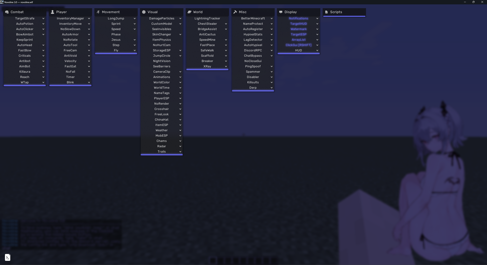
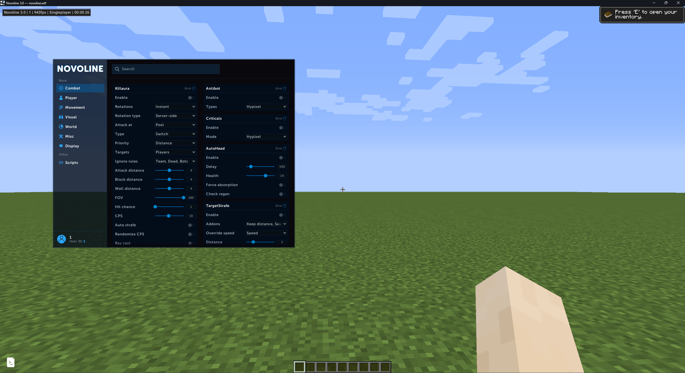
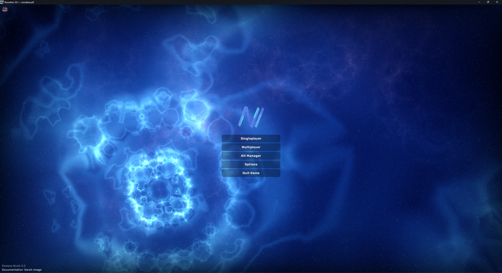
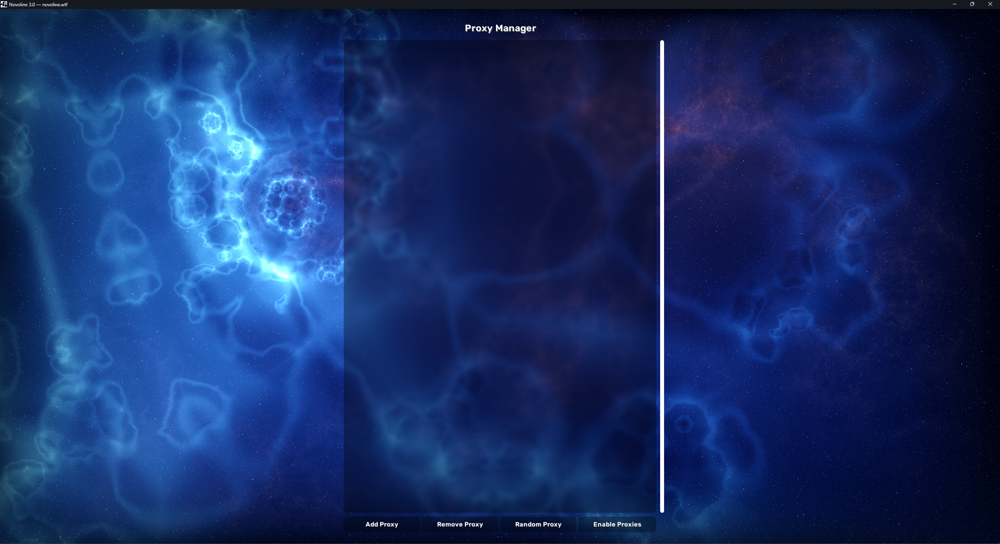

<p align="center">
  
</p>

<h1 align="center">OpenNovoline</h1>

<p align="center">
  A decompiled and remapped source tree of the Novoline client for Minecraft 1.8.9:
  the game with OptiFine built in, the Novoline modules, click GUI and script
  engine, and multi-version protocol support through ViaVersion.
</p>

<p align="center">
  <a href="#build-and-run"></a>
  <a href="#build-and-run"></a>
  <a href="#build-and-run"></a>
</p>

> OpenNovoline is an independent decompilation and source-preservation project. It is
> not an official Novoline release and is not affiliated with the original
> Novoline authors, Mojang, Microsoft, OptiFine, or ViaVersion.

## Overview

Novoline.wtf fully deobf source code (remap)

The original `Novoline-wtf.jar` was not created by this project's author. The
source in this repository is the decompiled and remapped result of that original
JAR.

Original file and reverse-engineering references:

- [Reversing Novoline](https://cubk.cn/articles/reversing-novoline)
- [StylesFoundation/Novoline-unlicensed](https://github.com/StylesFoundation/Novoline-unlicensed)

The original authorization and protection layer, including the loader, license
checks, and hardware checks, is intentionally omitted. The decompiled client
initializes directly.

## Screenshots

<p align="center">
  <a href="screenshot/1.png"></a>
  <a href="screenshot/2.png"></a>
</p>

<p align="center">
  <a href="screenshot/3.png"></a>
  <a href="screenshot/4.png"></a>
</p>

## Build and Run

On Linux:

```bash
./gradlew build
./gradlew test
./gradlew run
```

On Windows:

```powershell
.\gradlew.bat build
.\gradlew.bat test
.\gradlew.bat run
```

`./gradlew build` produces:

- `build/libs/OpenNovoline-1.0.0.jar`: reconstructed classes and resources.
- `build/libs/OpenNovoline-1.0.0-all.jar`: one JAR with the bundled third-party
  libraries, matching the shape of the original distribution.

The `run` task starts the client with an offline test account, the working
directory `run/game/`, and the local natives from `test_natives/`. The client
stores its settings in `run/game/Novoline/`.

## Game Assets

The game's sound files are not part of the repository. Run the asset task once:

```bash
./gradlew downloadAssets
```

The task reads the objects listed in `run/assets/indexes/1.8.json`. It first
tries to copy files from an installed Minecraft and downloads any missing files
from `resources.download.minecraft.net`, checking every SHA-1. The default local
assets directory is `%APPDATA%/.minecraft/assets` on Windows. Override it with:

```bash
./gradlew downloadAssets -Pnovoline.assetsDir="/path/to/.minecraft/assets"
```

The task fills `run/assets/objects` with 734 files, about 115 MB in total. The
client still starts without these assets, but it remains silent.

## License and Disclaimer

This repository does not claim ownership of Novoline, Minecraft, OptiFine, or
any third-party library. Rights to the decompiled source remain with their
respective holders. Bundled dependencies and resources retain their own
licenses; see the license files under `src/main/resources/` and inside the
corresponding JARs.

The decompiled source is provided for research, interoperability, and source
preservation. It comes with no warranty and no guarantee of fitness for any
particular use. Use it only where third-party clients, modifications, and
automation are permitted. You are responsible for complying with the Minecraft
EULA, server rules, and applicable law.
